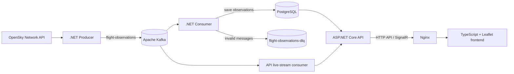

# FlightTracker

A containerized flight-tracking application built with **C# / .NET 10**, **Apache Kafka**, **PostgreSQL**, **SignalR**, **Leaflet**, and **Docker Compose**. It ingests aircraft observations from the OpenSky Network API, stores historical observations, and presents recent aircraft positions on an interactive map.

> **Project scope:** This repository currently uses Docker Compose. A Kubernetes migration is intentionally **out of scope for this version**.

## Features

- Retrieve aircraft state observations from OpenSky at a configured polling interval (currently **240 seconds**).
- Publish observations to the `flight-observations` Kafka topic.
- Store flight observations in PostgreSQL with source Kafka topic, partition, and offset metadata.
- Prevent duplicate database inserts for the same Kafka record using a unique index and `ON CONFLICT DO NOTHING`.
- Query latest observations, recent aircraft, historical observations, and inferred flight sessions through the HTTP API.
- Display aircraft locations on an interactive **Leaflet** map, with real-time updates via **SignalR**.
- Route invalid JSON messages to a `flight-observations-dlq` topic with their original payload and source metadata.
- Run backend, frontend, Kafka, and PostgreSQL together using Docker Compose.

## Architecture



**Processing order:** The consumer writes a valid observation to PostgreSQL before committing its Kafka offset. When parsing fails, it publishes a dead-letter message before committing the original offset. Consequently, processing is **at least once**; duplicate DLQ deliveries remain possible if a crash happens between DLQ publishing and the source-offset commit.

## Technology stack

| Layer | Technology |
| --- | --- |
| Data source | OpenSky Network API |
| Producer / Consumer / API | C# and .NET 10 |
| Messaging | Apache Kafka |
| Database | PostgreSQL 17 and Npgsql |
| Live updates | ASP.NET Core SignalR |
| Frontend | TypeScript, Vite, Leaflet |
| Reverse proxy | Nginx |
| Orchestration | Docker Compose |
| Tests | xUnit, PowerShell smoke test |

## Repository structure

```text
FlightTracker/
├── compose.yaml
├── Dockerfile.dotnet
├── .dockerignore
├── .env.example
├── FlightTracker.slnx
├── FlightTracker_smoke_test.ps1
├── database/
│   └── init/001_schema.sql
├── frontend/
│   ├── Dockerfile
│   ├── nginx.conf
│   ├── index.html
│   ├── vite.config.ts
│   └── src/
│       ├── main.ts
│       └── style.css
├── src/
│   ├── FlightTracker.Producer/
│   ├── FlightTracker.Consumer/
│   └── FlightTracker.Api/
└── tests/
    └── FlightTracker.Tests/
```

## Prerequisites

- Docker Engine / Docker Desktop with Docker Compose v2.
- Git (to clone and track changes).
- Optional for local development and tests: **.NET 10 SDK**, **Node.js**, and **npm**.

## Quick start

1. Clone the repository and enter the project directory:

   ```bash
   git clone <YOUR_REPOSITORY_URL>
   cd FlightTracker
   ```

2. Copy the example environment file to `.env`:

   **PowerShell:**

   ```powershell
   Copy-Item .env.example .env
   ```

   **Bash:**

   ```bash
   cp .env.example .env
   ```

   Replace all `CHANGE_ME` placeholders in `.env` with private, locally chosen values. **Do not commit `.env`** or paste real passwords into issues, logs, or documentation.

3. Validate and start the Compose services:

   ```bash
   docker compose config --quiet
   docker compose up -d --build
   docker compose ps
   ```

4. Ensure the dead-letter topic exists. Run this once after Kafka is healthy (it is safe to repeat because of `--if-not-exists`):

   ```bash
   docker compose exec -T kafka /opt/kafka/bin/kafka-topics.sh --bootstrap-server kafka:9092 --create --if-not-exists --topic flight-observations-dlq --partitions 1 --replication-factor 1
   ```

5. Open the app:

   - Frontend: `http://localhost/`
   - Direct API: `http://localhost:5050/`

The Compose configuration binds frontend port **80** and direct API port **5050** on the local machine. The frontend's Nginx proxy forwards `/api/` and `/hubs/` requests to the API service.

> **Data persistence:** The database uses persistent Docker storage. Do not run `docker compose down -v` unless you intentionally want to delete volume data. PostgreSQL initialization scripts are generally applied on first database initialization, not on each container restart.

## HTTP API

| Endpoint | Purpose |
| --- | --- |
| `GET /api/flights/latest` | Latest known observation per aircraft |
| `GET /api/flights/latest?onlyRecent=true` | Aircraft with recently received observations (the current application uses a roughly 10-minute window) |
| `GET /api/flights/{icao24}/history` | Observation history for an aircraft |
| `GET /api/flights/{icao24}/sessions?limit=500` | Grouped flight sessions for an aircraft |
| `GET /api/flights/archive?fromUtc=...&toUtc=...&limit=1000` | Archived observations for a UTC time range |
| `/hubs/flights` | SignalR endpoint for live updates |

**Examples:**

```powershell
Invoke-RestMethod 'http://localhost:5050/api/flights/latest?onlyRecent=true'
Invoke-RestMethod 'http://localhost:5050/api/flights/4bc8ce/sessions?limit=500'
Invoke-RestMethod 'http://localhost:5050/api/flights/archive?fromUtc=2026-10-13T21%3A00%3A00Z&toUtc=2026-10-14T21%3A00%3A00Z&limit=1000'
```

## Kafka reliability and DLQ

- Main topic: `flight-observations`.
- Dead-letter topic: `flight-observations-dlq`.
- Consumer offsets are committed manually after successful database processing or successful DLQ publication.
- PostgreSQL enforces uniqueness of `(kafka_topic, kafka_partition, kafka_offset)`.
- The consumer retries transient PostgreSQL errors with increasing delays, up to a configured limit.
- Dead-letter records include `sourceTopic`, `sourcePartition`, `sourceOffset`, `originalKey`, `originalValue`, `reason`, and `failedAtUtc`.
- The DLQ helps isolate invalid JSON messages; it is **not** a replacement for monitoring, retention management, or an operator-controlled replay workflow.

Inspect topic and consumer lag:

```powershell
docker compose exec -T kafka /opt/kafka/bin/kafka-topics.sh --bootstrap-server kafka:9092 --describe --topic flight-observations-dlq
docker compose exec -T kafka /opt/kafka/bin/kafka-consumer-groups.sh --bootstrap-server kafka:9092 --describe --group flighttracker-postgres-consumer-v2
```

## Tests and builds

**Backend tests** (start the Compose services first because some tests call the running API at `http://localhost:5050`):

```powershell
dotnet test FlightTracker.slnx --verbosity minimal
```

**Frontend production build:**

```powershell
npm.cmd --prefix .\frontend run build
```

**Operational smoke test** (PowerShell):

```powershell
powershell -ExecutionPolicy Bypass -File .\FlightTracker_smoke_test.ps1
```

The smoke test reports service and API checks but may print error messages without exiting as a failing test process; use the xUnit results for automated pass/fail and inspect smoke-test output separately.

**Latest observed development verification (2026-11-02):** xUnit **21 passed, 0 failed**; Vite production build completed. The system was also manually exercised for consumer restarts, replay of duplicate Kafka offsets, a short PostgreSQL outage, and invalid-JSON delivery to the DLQ. These are recorded observations, not a guarantee for every deployment.

## Development notes

- Never commit real passwords, API keys, `.env`, generated build folders, or backup files.
- The API and frontend may briefly show stale or unavailable information during component outages; check container logs and Kafka lag when diagnosing issues.
- The live map shows **recent** aircraft only; the all-time latest endpoint can include older observations.
- Kafka's console-producer CLI can time out; always inspect delivery logs and downstream offsets before resending a test message.
- This repository does not yet include Kubernetes manifests. Do not assume the Compose setup is directly production-ready.

## Next steps

- Complete repository security and code-cleanup review.
- Verify a fresh installation from documented prerequisites.
- Add more repeatable failure-path and end-to-end tests as needed.
- Plan Kubernetes only as a separate, future phase.

## Data source

Aircraft observations originate from the [OpenSky Network](https://opensky-network.org/). Availability, rate limits, and data completeness depend on the data provider.
